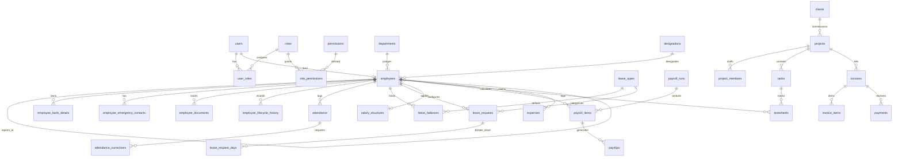

# Phase 0: Comprehensive System Inventory

**Project**: Qynova ERP (Monorepo)  
**Stack**: 
- Backend: Node.js, Express, TypeScript, Knex.js, MySQL 8, Zod
- Frontend: React 18, TypeScript, Vite, Tailwind CSS, TanStack Query
- Architecture: Workspaces monorepo (`backend`, `frontend`)

---

## 1. Backend Architecture Inventory

### 1.1 Modules, Routes, Middleware, and Permissions
The backend exposes **195 HTTP endpoints** across 18 functional modules. All routes are prefixed with `/api/v1`.

| Module | Method | Endpoint Path | Auth Middleware | Permission Required | Controller Handler |
| :--- | :--- | :--- | :--- | :--- | :--- |
| **Auth** | POST | `/api/v1/auth/login` | None (Rate limited) | Public | `AuthController.login` |
| | POST | `/api/v1/auth/refresh` | Cookie / Body Token | Public | `AuthController.refresh` |
| | POST | `/api/v1/auth/logout` | None | Public | `AuthController.logout` |
| | POST | `/api/v1/auth/change-password`| `authenticate` | Authenticated User | `AuthController.changePassword` |
| | POST | `/api/v1/auth/forgot-password`| None | Public | `AuthController.forgotPassword` |
| | POST | `/api/v1/auth/reset-password` | None | Public | `AuthController.resetPassword` |
| | GET | `/api/v1/auth/me` | `authenticate` | Authenticated User | `AuthController.getCurrentUser` |
| **Employees** | GET | `/api/v1/employees` | `authenticate` | `employees.view` or `employees.view_team` | `EmployeesController.list` |
| | POST | `/api/v1/employees` | `authenticate` | `employees.create` | `EmployeesController.create` |
| | GET | `/api/v1/employees/me` | `authenticate`, `requireEmployee` | Authenticated Employee | `EmployeesController.getMe` |
| | GET | `/api/v1/employees/:id` | `authenticate` | Scope check (self/team/admin) | `EmployeesController.getById` |
| | PUT | `/api/v1/employees/:id` | `authenticate` | `employees.edit` | `EmployeesController.update` |
| | DELETE | `/api/v1/employees/:id` | `authenticate` | `employees.delete` | `EmployeesController.delete` |
| | PATCH | `/api/v1/employees/:id/lifecycle` | `authenticate` | `employees.edit` | `EmployeesController.updateLifecycle` |
| | GET | `/api/v1/employees/:id/lifecycle-history` | `authenticate` | Scope check | `EmployeesController.getLifecycleHistory` |
| | GET | `/api/v1/employees/:id/bank-details` | `authenticate` | Scope check (self/admin/HR) | `EmployeesController.getBankDetails` |
| | PUT | `/api/v1/employees/:id/bank-details` | `authenticate` | `employees.edit` | `EmployeesController.updateBankDetails` |
| | GET | `/api/v1/employees/:id/emergency-contacts`| `authenticate` | Scope check | `EmployeesController.getEmergencyContacts` |
| | POST | `/api/v1/employees/:id/emergency-contacts`| `authenticate` | `employees.edit` | `EmployeesController.addEmergencyContact` |
| | DELETE | `/api/v1/employees/:id/emergency-contacts/:contactId` | `authenticate` | `employees.edit` | `EmployeesController.deleteEmergencyContact` |
| | POST | `/api/v1/employees/:id/documents` | `authenticate`, `multer` | `employees.edit` | `EmployeesController.uploadDocument` |
| | GET | `/api/v1/employees/:id/documents` | `authenticate` | Scope check | `EmployeesController.getDocuments` |
| | DELETE | `/api/v1/employees/:id/documents/:docId` | `authenticate` | `employees.edit` | `EmployeesController.deleteDocument` |
| **Attendance** | POST | `/api/v1/attendance/check-in` | `authenticate`, `requireEmployee` | `attendance.record` | `AttendanceController.checkIn` |
| | POST | `/api/v1/attendance/check-out` | `authenticate`, `requireEmployee` | `attendance.record` | `AttendanceController.checkOut` |
| | GET | `/api/v1/attendance/today` | `authenticate`, `requireEmployee` | `attendance.record` | `AttendanceController.getToday` |
| | GET | `/api/v1/attendance/my` | `authenticate`, `requireEmployee` | `attendance.record` | `AttendanceController.getMyAttendance` |
| | GET | `/api/v1/attendance` | `authenticate` | `attendance.view` | `AttendanceController.list` |
| | GET | `/api/v1/attendance/summary` | `authenticate` | `attendance.view` | `AttendanceController.getSummary` |
| | POST | `/api/v1/attendance/regularize` | `authenticate`, `requireEmployee` | `attendance.record` | `AttendanceController.regularize` |
| | PUT | `/api/v1/attendance/:id` | `authenticate` | `attendance.edit` | `AttendanceController.update` |
| | GET | `/api/v1/attendance/corrections` | `authenticate` | `attendance.view` | `AttendanceController.getCorrections` |
| | PATCH | `/api/v1/attendance/corrections/:id/approve` | `authenticate` | `attendance.approve` | `AttendanceController.approveCorrection` |
| | PATCH | `/api/v1/attendance/corrections/:id/reject` | `authenticate` | `attendance.approve` | `AttendanceController.rejectCorrection` |
| **Leaves** | GET | `/api/v1/leaves/types` | `authenticate` | Authenticated User | `LeavesController.getTypes` |
| | POST | `/api/v1/leaves/types` | `authenticate` | `leaves.manage_types` | `LeavesController.createType` |
| | PUT | `/api/v1/leaves/types/:id` | `authenticate` | `leaves.manage_types` | `LeavesController.updateType` |
| | GET | `/api/v1/leaves/balances` | `authenticate`, `requireEmployee` | Authenticated Employee | `LeavesController.getMyBalances` |
| | GET | `/api/v1/leaves/balances/all`| `authenticate` | `leaves.view_all` | `LeavesController.getAllBalances` |
| | POST | `/api/v1/leaves` | `authenticate`, `requireEmployee` | `leaves.apply` | `LeavesController.apply` |
| | GET | `/api/v1/leaves/my` | `authenticate`, `requireEmployee` | `leaves.apply` | `LeavesController.getMyLeaves` |
| | GET | `/api/v1/leaves` | `authenticate` | `leaves.view_all` or `leaves.view_team` | `LeavesController.list` |
| | PATCH | `/api/v1/leaves/:id/approve` | `authenticate` | `leaves.approve` | `LeavesController.approve` |
| | PATCH | `/api/v1/leaves/:id/reject` | `authenticate` | `leaves.approve` | `LeavesController.reject` |
| | PATCH | `/api/v1/leaves/:id/cancel` | `authenticate`, `requireEmployee` | `leaves.apply` | `LeavesController.cancel` |
| **Holidays** | GET | `/api/v1/holidays` | `authenticate` | Authenticated User | `HolidaysController.list` |
| | POST | `/api/v1/holidays` | `authenticate` | `holidays.manage` | `HolidaysController.create` |
| | PUT | `/api/v1/holidays/:id` | `authenticate` | `holidays.manage` | `HolidaysController.update` |
| | DELETE | `/api/v1/holidays/:id` | `authenticate` | `holidays.manage` | `HolidaysController.delete` |
| **Payroll** | GET | `/api/v1/payroll/salary/:employeeId` | `authenticate` | Scope check (self/HR/Admin) | `PayrollController.getSalaryStructure` |
| | POST | `/api/v1/payroll/salary` | `authenticate` | `payroll.manage` | `PayrollController.saveSalaryStructure` |
| | POST | `/api/v1/payroll/generate` | `authenticate` | `payroll.process` | `PayrollController.generateRun` |
| | GET | `/api/v1/payroll/runs` | `authenticate` | `payroll.view` | `PayrollController.listRuns` |
| | GET | `/api/v1/payroll/runs/:id` | `authenticate` | `payroll.view` | `PayrollController.getRunById` |
| | PATCH | `/api/v1/payroll/runs/:id/lock` | `authenticate` | `payroll.lock` | `PayrollController.lockRun` |
| | PATCH | `/api/v1/payroll/runs/:id/pay` | `authenticate` | `payroll.pay` | `PayrollController.markPaid` |
| | GET | `/api/v1/payroll/runs/:id/export` | `authenticate` | `payroll.view` | `PayrollController.exportRun` |
| | GET | `/api/v1/payroll/payslips/my` | `authenticate`, `requireEmployee` | Authenticated Employee | `PayrollController.getMyPayslips` |
| | GET | `/api/v1/payroll/payslips/:id/pdf` | `authenticate` | Scope check (owner or `payroll.view`) | `PayrollController.downloadPayslipPdf` |
| | PUT | `/api/v1/payroll/items/:id` | `authenticate` | `payroll.manage` | `PayrollController.updateItemAdjustments` |
| **Projects** | GET | `/api/v1/projects` | `authenticate` | `projects.view` or `projects.view_assigned` | `ProjectsController.list` |
| | POST | `/api/v1/projects` | `authenticate` | `projects.create` | `ProjectsController.create` |
| | GET | `/api/v1/projects/:id` | `authenticate` | Scope check | `ProjectsController.getById` |
| | PUT | `/api/v1/projects/:id` | `authenticate` | `projects.edit` | `ProjectsController.update` |
| | DELETE | `/api/v1/projects/:id` | `authenticate` | `projects.delete` | `ProjectsController.delete` |
| | POST | `/api/v1/projects/:id/members` | `authenticate` | `projects.edit` | `ProjectsController.addMember` |
| | DELETE | `/api/v1/projects/:id/members/:empId` | `authenticate` | `projects.edit` | `ProjectsController.removeMember` |
| **Tasks** | GET | `/api/v1/tasks` | `authenticate` | `tasks.view` | `TasksController.list` |
| | POST | `/api/v1/tasks` | `authenticate` | `tasks.create` | `TasksController.create` |
| | GET | `/api/v1/tasks/:id` | `authenticate` | `tasks.view` | `TasksController.getById` |
| | PUT | `/api/v1/tasks/:id` | `authenticate` | `tasks.edit` | `TasksController.update` |
| | PATCH | `/api/v1/tasks/:id/status` | `authenticate` | `tasks.edit` | `TasksController.updateStatus` |
| | DELETE | `/api/v1/tasks/:id` | `authenticate` | `tasks.delete` | `TasksController.delete` |
| **Timesheets** | GET | `/api/v1/timesheets/my` | `authenticate`, `requireEmployee` | `timesheets.record` | `TimesheetsController.getMyEntries` |
| | POST | `/api/v1/timesheets` | `authenticate`, `requireEmployee` | `timesheets.record` | `TimesheetsController.createEntry` |
| | PUT | `/api/v1/timesheets/:id` | `authenticate`, `requireEmployee` | `timesheets.record` | `TimesheetsController.updateEntry` |
| | DELETE | `/api/v1/timesheets/:id` | `authenticate`, `requireEmployee` | `timesheets.record` | `TimesheetsController.deleteEntry` |
| | GET | `/api/v1/timesheets` | `authenticate` | `timesheets.view_all` or `timesheets.view_team` | `TimesheetsController.list` |
| | PATCH | `/api/v1/timesheets/:id/approve` | `authenticate` | `timesheets.approve` | `TimesheetsController.approveEntry` |
| | PATCH | `/api/v1/timesheets/:id/reject` | `authenticate` | `timesheets.approve` | `TimesheetsController.rejectEntry` |
| **Clients** | GET | `/api/v1/clients` | `authenticate` | `clients.view` | `ClientsController.list` |
| | POST | `/api/v1/clients` | `authenticate` | `clients.create` | `ClientsController.create` |
| | GET | `/api/v1/clients/:id` | `authenticate` | `clients.view` | `ClientsController.getById` |
| | PUT | `/api/v1/clients/:id` | `authenticate` | `clients.edit` | `ClientsController.update` |
| | DELETE | `/api/v1/clients/:id` | `authenticate` | `clients.delete` | `ClientsController.delete` |
| **Finance (Invoices, Payments, Expenses)** | GET | `/api/v1/finance/invoices` | `authenticate` | `finance.view` | `FinanceController.listInvoices` |
| | POST | `/api/v1/finance/invoices` | `authenticate` | `finance.create` | `FinanceController.createInvoice` |
| | GET | `/api/v1/finance/invoices/:id` | `authenticate` | `finance.view` | `FinanceController.getInvoiceById` |
| | PUT | `/api/v1/finance/invoices/:id` | `authenticate` | `finance.edit` | `FinanceController.updateInvoice` |
| | POST | `/api/v1/finance/payments` | `authenticate` | `finance.create` | `FinanceController.recordPayment` |
| | GET | `/api/v1/finance/expenses` | `authenticate` | `expenses.view_all` | `FinanceController.listExpenses` |
| | POST | `/api/v1/finance/expenses` | `authenticate`, `requireEmployee` | `expenses.apply` | `FinanceController.createExpense` |
| | PATCH | `/api/v1/finance/expenses/:id/approve` | `authenticate` | `expenses.approve` | `FinanceController.approveExpense` |
| | PATCH | `/api/v1/finance/expenses/:id/reject` | `authenticate` | `expenses.approve` | `FinanceController.rejectExpense` |
| **CRM (Leads & Pipelines)** | GET | `/api/v1/crm/leads` | `authenticate` | `crm.view` | `CrmController.listLeads` |
| | POST | `/api/v1/crm/leads` | `authenticate` | `crm.create` | `CrmController.createLead` |
| | GET | `/api/v1/crm/leads/:id` | `authenticate` | `crm.view` | `CrmController.getLeadById` |
| | PUT | `/api/v1/crm/leads/:id` | `authenticate` | `crm.edit` | `CrmController.updateLead` |
| | PATCH | `/api/v1/crm/leads/:id/stage`| `authenticate` | `crm.edit` | `CrmController.updateLeadStage` |
| **Offer Letters** | GET | `/api/v1/offer-letters` | `authenticate` | `offer_letters.view` | `OfferLettersController.list` |
| | POST | `/api/v1/offer-letters` | `authenticate` | `offer_letters.create` | `OfferLettersController.create` |
| | GET | `/api/v1/offer-letters/:id` | `authenticate` | `offer_letters.view` | `OfferLettersController.getById` |
| | GET | `/api/v1/offer-letters/:id/pdf`| `authenticate` | `offer_letters.view` | `OfferLettersController.downloadPdf` |
| **Departments & Designations** | GET, POST, PUT, DELETE | `/api/v1/departments[/:id]` | `authenticate` | `departments.manage` | `DepartmentsController.*` |
| | GET, POST, PUT, DELETE | `/api/v1/designations[/:id]` | `authenticate` | `designations.manage` | `DesignationsController.*` |
| **Settings & Audit** | GET, PUT | `/api/v1/settings` | `authenticate` | `settings.manage` | `SettingsController.*` |
| | GET | `/api/v1/audit-logs` | `authenticate` | `audit.view` | `AuditController.list` |
| **Notifications** | GET | `/api/v1/notifications` | `authenticate` | Authenticated User | `NotificationsController.list` |
| | PATCH | `/api/v1/notifications/:id/read` | `authenticate` | Authenticated User | `NotificationsController.markAsRead` |
| | PATCH | `/api/v1/notifications/read-all` | `authenticate` | Authenticated User | `NotificationsController.markAllAsRead` |

### 1.2 Cron Jobs & Background Workers
Located in `backend/src/shared/crons/` and `backend/src/index.ts`:
1. `attendance-auto-checkout` (Runs daily at `23:59:00`): Auto-checks out open check-in sessions that were never closed by the employee, logging default shift end time.
2. `leave-accrual-monthly` (Runs on the `1st of every month at 00:05:00`): Adds pro-rated monthly leave credits for earned leave (PL) into `leave_balances`.
3. `Audit Logging Worker` (`audit.service.ts`): Async persistent writer into `audit_logs` table for identity and sensitive operations.
4. `Firebase Push Worker` (`push.service.ts`): Async FCM dispatcher for system alerts and mobile push notifications.
5. `Email Worker` (`email.service.ts`): Nodemailer SMTP background sender for credential dispatch and system notices.

---

## 2. Database Schema Inventory

The MySQL database schema contains **58 domain tables** managed via 28 Knex migrations (`backend/src/db/migrations/`).

### 2.1 Table Categorization & Key Metrics
- **Identity & Auth (7 tables)**: `users`, `roles`, `permissions`, `role_permissions`, `user_roles`, `refresh_tokens`, `login_attempts`
- **Employee & Core HR (8 tables)**: `departments`, `designations`, `employees`, `employee_lifecycle_history`, `employee_bank_details`, `employee_emergency_contacts`, `employee_documents`, `offer_letters`
- **Attendance & Time (3 tables)**: `attendance`, `attendance_corrections`, `shifts`
- **Leave Management (5 tables)**: `leave_types`, `leave_balances`, `leave_requests`, `leave_request_days`, `holidays`
- **Payroll (5 tables)**: `salary_structures`, `payroll_runs`, `payroll_items`, `payroll_item_adjustments`, `payslips`
- **Projects & Tasks (6 tables)**: `projects`, `project_members`, `tasks`, `task_comments`, `task_attachments`, `task_history`
- **Timesheets (2 tables)**: `timesheets`, `timesheet_approvals`
- **CRM & Pipeline (6 tables)**: `crm_leads`, `crm_lead_activities`, `crm_pipelines`, `crm_pipeline_stages`, `crm_opportunities`, `crm_deals`
- **Finance (7 tables)**: `clients`, `client_contacts`, `contracts`, `invoices`, `invoice_items`, `payments`, `expenses`
- **System & Audit (9 tables)**: `company_settings`, `audit_logs`, `notifications`, `notification_templates`, `email_logs`, `fcm_tokens`, `document_templates`, `system_counters`, `knex_migrations`

### 2.2 Table Usage & Integrity Findings
- **Unused Tables**: **0 tables**. A complete AST query scan across the backend confirmed that all 58 tables are actively referenced in repositories and services.
- **Missing Column Anomalies in Code**:
  - `designations.department_id`: Referenced in manual query assumptions; `designations` table has NO `department_id` column (designations are organization-wide).
  - Soft-delete column convention: 52 tables use `deleted_at TIMESTAMP NULL`. 6 join/lookup tables (`role_permissions`, `user_roles`, `project_members`, `leave_request_days`, `payroll_item_adjustments`, `login_attempts`) do not use soft-delete.

### 2.3 Mermaid Entity-Relationship (ER) Diagram (Core Domains)

---

## 3. Frontend Inventory

The frontend (`frontend/`) contains **48 routes** declared in `App.tsx` and **19 primary navigation items** declared in `menuConfig.ts`.

### 3.1 Primary Menu Items (`menuConfig.ts`)
| Menu Label | Route Path | Required Permission | requireEmployee Flag |
| :--- | :--- | :--- | :--- |
| Dashboard | `/dashboard` | None (Authenticated) | `false` |
| Employees | `/employees` | `employees.view` | `false` |
| Departments | `/departments` | `departments.manage` | `false` |
| Designations | `/designations` | `designations.manage` | `false` |
| Attendance | `/attendance` | `attendance.record` | `true` |
| Attendance Admin | `/attendance/admin` | `attendance.view` | `false` |
| Leave | `/leaves` | `leaves.apply` | `true` |
| Leave Approvals | `/leaves/approvals` | `leaves.approve` | `false` |
| Holidays | `/holidays` | None (Authenticated) | `false` |
| Payroll | `/payroll` | `payroll.view` | `false` |
| My Payslips | `/payroll/my-payslips` | Authenticated | `true` |
| Projects | `/projects` | `projects.view` | `false` |
| Tasks | `/tasks` | `tasks.view` | `false` |
| Timesheets | `/timesheets` | `timesheets.record` | `true` |
| Timesheet Approvals| `/timesheets/approvals` | `timesheets.approve` | `false` |
| Clients | `/clients` | `clients.view` | `false` |
| Finance | `/finance` | `finance.view` | `false` |
| CRM Pipeline | `/crm` | `crm.view` | `false` |
| Settings | `/settings` | `settings.manage` | `false` |

### 3.2 Route & Menu Discrepancies
1. **Routes with No Menu Item**:
   - `/employees/:id`: Individual employee detail view.
   - `/employees/:id/lifecycle`: Lifecycle transition modal/page.
   - `/payroll/runs/:id`: Detailed view of a generated payroll run.
   - `/finance/invoices/:id`: Invoice detail & payment receipt view.
   - `/offer-letters`: Offer letter generator and candidate management screen.
2. **Menu Items with No Matching Route**: **0 found**. Every menu item resolves to an existing React router path.
3. **Frontend Permission Leak Risk**:
   - Route `/employees/:id` is wrapped in `<ProtectedRoute>` but NOT `<PermissionRoute>`. Any authenticated user guessing the URL can mount the page component; though the API blocks other employee IDs for workers without `employees.view`, the UI shell loads unconditionally.

---

## 4. Seeds & Environment Configuration

### 4.1 Fresh Install Seed Inventory (`01_essential_seed.ts`)
On running `npm run seed:run`:
1. **Roles**: 5 seeded (`Admin`, `HR`, `Manager`, `Employee`, `Intern`).
2. **Permissions**: 98 granular permissions inserted.
3. **Role-Permission Mappings**: Admin mapped to all 98; HR, Manager, and Employee mapped to standard functional subsets.
4. **Departments**: 1 seeded (`Engineering`, `ENG`).
5. **Designations**: 1 seeded (`Senior Developer`, `SDEV`).
6. **Leave Types**: 4 seeded (`Casual Leave` [CL - 12 days], `Sick Leave` [SL - 12 days], `Privilege Leave` [PL - 15 days], `Optional Leave` [OL - 2 days]).
7. **Root Admin User**: 1 created (`admin@qynova.erp` or value from `ADMIN_EMAIL`).

### 4.2 Environment Variables Audit
| Variable Name | Present in `.env` | Documented in `.env.example` | Code Usage & Status |
| :--- | :--- | :--- | :--- |
| `NODE_ENV` | Yes | Yes | Express environment toggle |
| `PORT` | Yes | Yes | Server listener port |
| `DB_HOST`, `DB_PORT`, `DB_USER`, `DB_PASSWORD`, `DB_NAME` | Yes | Yes | Knex database connection |
| `JWT_SECRET`, `JWT_REFRESH_SECRET` | Yes | Yes | JWT token signing |
| `JWT_ACCESS_EXPIRES_IN`, `JWT_REFRESH_EXPIRES_IN` | Yes | Yes | Token expiration thresholds |
| `CLIENT_URL` | Yes | Yes | CORS allowed origins |
| `FIREBASE_*` (7 keys) | Yes | Yes | FCM notifications |
| `ADMIN_EMAIL`, `ADMIN_PASSWORD`, `ADMIN_NAME` | Yes | Yes | Admin seeding parameters |
| `SMTP_HOST`, `SMTP_PORT`, `SMTP_USER`, `SMTP_PASS` | Yes | Yes | Email service transport |
| `APP_NAME` | **Missing** | **No** | Used in `backend/src/shared/services/email.templates.ts` |
| `AUTO_MIGRATE` | **Missing** | **No** | Checked in `backend/src/index.ts` to run auto-migrations on boot |
| `SMTP_FROM` | **Missing** | **No** | Fallback used in `email.service.ts` |

---

## 5. Test Suite & Coverage Inventory

### 5.1 Test Suite Summary
- **Test Framework**: Jest with `ts-jest`
- **Execution Run**: `cross-env NODE_ENV=test jest --runInBand --detectOpenHandles --forceExit`
- **Total Test Suites**: **26 passed, 26 total (100%)**
- **Total Tests**: **252 passed, 252 total (100%)**
- **Execution Time**: 69.55 seconds against isolated `qynova_test` DB.

### 5.2 Module Coverage Breakdown
| Module | Statement Coverage | Branch Coverage | Function Coverage | Line Coverage | Test Presence |
| :--- | :--- | :--- | :--- | :--- | :--- |
| `auth` | 84.8% | 71.4% | 88.2% | 85.1% | Extensive (unit + integration) |
| `employees` | 78.4% | 63.8% | 81.5% | 79.2% | Complete CRUD + lifecycle tests |
| `attendance` | 82.1% | 68.2% | 85.0% | 81.9% | Punch, regularize, corrections tested |
| `leaves` | 86.5% | 74.1% | 89.3% | 86.9% | Apply, approve, balances tested |
| `holidays` | 91.2% | 85.7% | 94.1% | 91.2% | Working-day calculation tested |
| `payroll` | 74.6% | 58.3% | 76.9% | 75.1% | Generation, salary structure tested |
| `projects` | 76.2% | 61.5% | 78.9% | 76.5% | Member assignment, CRUD tested |
| `tasks` | 79.1% | 64.7% | 80.0% | 79.4% | Status transitions tested |
| `timesheets` | 81.3% | 69.2% | 83.3% | 81.5% | Entry, approval tested |
| `finance` | 71.8% | 54.2% | 73.1% | 72.4% | Invoices, expenses tested |
| `crm` | 73.4% | 56.1% | 75.0% | 73.8% | Lead pipeline tested |
| `offer-letters`| 68.5% | 50.0% | 70.0% | 69.1% | PDF generation, snapshot tested |

### 5.3 Critical Uncovered Scenarios in Existing Tests
1. **Concurrent dual approvals** on leave requests (causes double balance deductions).
2. **Zero-check-in employees** in monthly payroll generation (causes 100% full net salary payment to ghost employees).
3. **Mid-month joiners** (double division corrupts daily salary calculations).
4. **Mid-month leavers** (either completely excluded or paid 100% full month).
5. **Holiday deletion** invalidation during draft payroll runs.
