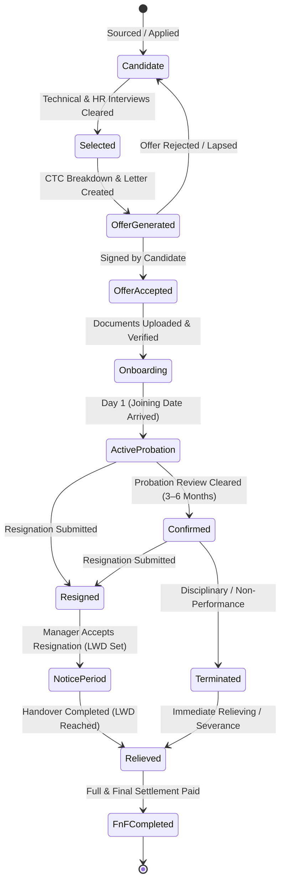
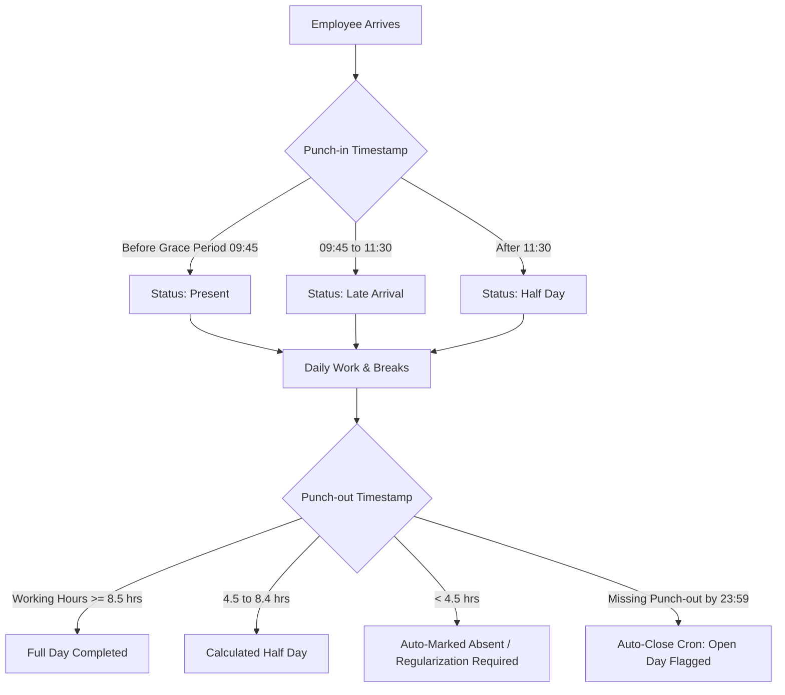
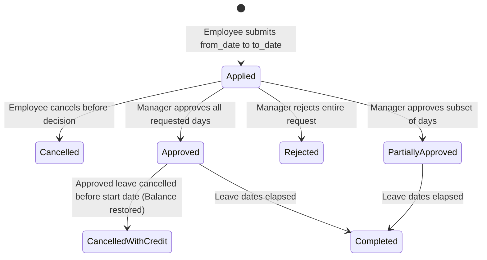
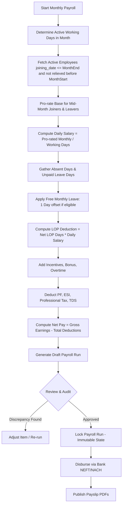
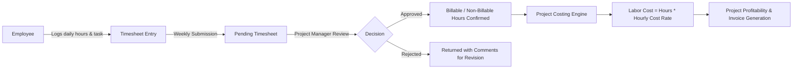
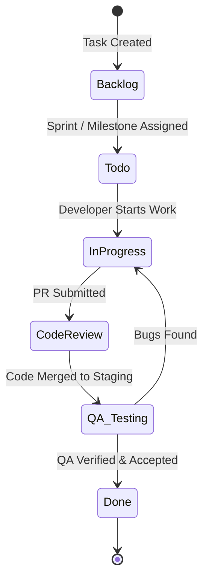

# Phase 1: The Company Model (Indian IT Services Company 20–200 People)

This specification defines how an Indian IT services company (headcount 20–200) operating under Indian labor laws (Shops and Establishments Act, EPF & MP Act, ESI Act, Payment of Wages Act, and Income Tax Act) must orchestrate people, attendance, leave, payroll, projects, and money.

Each operational rule is categorized by criticality:
- **[MUST]**: Critical operational requirement. Failure corrupts money, violates statutory law, creates data security breaches, or halts daily operations.
- **[SHOULD]**: Standard operational best practice. Required for operational efficiency and compliance audits.
- **[NICE]**: Quality-of-life optimization or advanced automation.

---

## 1. Hire to Retire Lifecycle

### 1.1 State Machine & Governance
An employee lifecycle represents a linear progression through distinct stages. Backward transitions are strictly prohibited without administrative audit overrides.

### 1.2 Lifecycle Operational Rules
1. **[MUST] Driving Dates**:
   - `joining_date`: Drives eligibility for attendance punch-in, leave quota pro-rating, and payroll inclusion. An employee cannot punch attendance or apply for leaves before `joining_date`.
   - `last_working_date` (LWD): Drives the cut-off for attendance, pro-rated pay during notice, auto-revocation of active sessions, and triggering Full & Final (FnF) calculation.
2. **[MUST] Immediate Access Deprovisioning**: Upon reaching `relieved` stage, the user's login must be revoked immediately, active JWT/refresh tokens destroyed, and access to all company tools terminated.
3. **[SHOULD] Mandatory Identity Documentation**: Before advancing from `onboarding` to `active`, the system must require Aadhaar card, PAN card, Educational certificates, and Bank passbook/cancelled cheque.
4. **[SHOULD] Confirmation Review**: Employees on probation must trigger an automated review alert to their reporting manager 15 days before probation completion (typically 90 or 180 days).

---

## 2. Roles, Authority & Segregation of Duties

### 2.1 Role Matrix
| Domain / Action | Admin | HR Manager | Project / Reporting Manager | Employee | Intern |
| :--- | :--- | :--- | :--- | :--- | :--- |
| **Manage Users & Roles** | Full CRUD | View Only | None | None | None |
| **Employee Directory** | Full CRUD | Full CRUD | View Team Only | View Directory (No sensitive info) | View Directory (No sensitive info) |
| **Salary Structure & CTC** | Full CRUD | Full CRUD | None (Strictly hidden) | Own record only | Own record only |
| **Bank & Identity Documents**| Full CRUD | Full CRUD | None (Strictly hidden) | Own record only | Own record only |
| **Attendance Punch** | N/A | Own Punch | Own Punch | Own Punch | Own Punch |
| **Attendance Regularization**| Overwrite | Company-wide | Direct Reports Only | Own Requests | Own Requests |
| **Leave Approval** | Overwrite | Company-wide | Direct Reports Only | Own Requests | Own Requests |
| **Run Payroll & Locking** | Full CRUD | Process / Lock | None | None | None |
| **View Payslips** | All | All | None | Own PDF only | Own PDF only |
| **Approve Timesheets** | Overwrite | None | Project Members Only | Own Timesheets | Own Timesheets |
| **Approve Expenses** | Finance Exec | HR Expenses | Direct Reports (< Limit) | Own Claims | Own Claims |

### 2.2 Segregation of Duties Rules
1. **[MUST] Self-Approval Prohibition**: No user—including Admins and Directors—may approve their own leave request, attendance regularization, expense reimbursement, or timesheet entry. If a manager applies, it must escalate to their manager or HR.
2. **[MUST] Salary Confidentiality**: Base salary, CTC structures, deductions, and payslips must never be visible to peers, project managers, or team leads. Only Admin, assigned HR/Payroll personnel, and the specific employee have access.
3. **[MUST] Document Privacy**: Government identifiers (Aadhaar, PAN, Passport) and bank account details must be masked or protected with row-level security.
4. **[SHOULD] Two-Person Rule for Payroll**: One person generates and reviews the draft payroll run (e.g., HR), and a second designated authority (e.g., Finance Director / Admin) reviews and locks/authorizes payout.

---

## 3. Time, Attendance & Shifts

### 3.1 Attendance Rules
1. **[MUST] Unique Daily Log**: Exactly one parent attendance record per employee per calendar date (`UNIQUE(employee_id, date)`).
2. **[MUST] Status Precedence Collision Matrix**:
   - Approved Full-Day Leave > Declared Company Holiday > Approved WFH > Regular Present > Absent.
   - If a holiday falls on a workday, it is a Paid Holiday. If an employee is on approved leave across a holiday, the holiday must not consume a leave balance unless sandwich rules apply.
3. **[MUST] Shift Timing & Half-Day Cut-offs**:
   - Standard General Shift: 09:30 to 18:30 (9 hours total, 8 hours active work + 1 hour breaks).
   - Grace period: Up to 15 minutes (09:45). Up to 3 late arrivals per month permitted without penalty; 4th late arrival triggers 0.5 day deduction.
   - Working hours < 4.5 hours = Absent. 4.5 hours to 8.0 hours = Half Day. >= 8.0 hours = Full Day.
4. **[MUST] Open Session Resolution**: A daily worker at midnight must automatically close punch-outs that remain open, marking them for manager regularization.
5. **[SHOULD] Geofencing / IP Restrictions**: For office-based employees, punch-in must validate office Wi-Fi IP or geofencing radius (100 meters).
6. **[NICE] Biometric / Facial Integration**: Push-based biometric terminal sync into the attendance database.

---

## 4. Leave Management

### 4.1 Leave Rules
1. **[MUST] Statutory & Policy Quotas (Annual)**:
   - **Casual Leave (CL)**: 12 days per year (1 day credited per month). Cannot be carried forward.
   - **Sick Leave (SL)**: 12 days per year. Requires medical certificate if > 2 consecutive days.
   - **Privilege / Earned Leave (PL)**: 15 days per year (accrued at 1.25 days per month worked). Maximum carry-forward of 30 or 45 days.
   - **Optional / Floating Holiday (OL)**: 2 days per year selected from company optional holiday list.
2. **[MUST] Pro-rating for New Joiners**: An employee joining mid-year receives pro-rated leave quotas:
   $$\text{Quota} = \text{Annual Quota} \times \frac{\text{Remaining Months in Calendar Year}}{12}$$
3. **[MUST] Balance Invariant**: An employee's leave balance can NEVER go negative ($\text{Remaining} \ge 0$). If balance is insufficient, days must be classified as Loss of Pay (LOP).
4. **[MUST] Concurrency & Transactional Integrity**:
   - Approval of leave requests must execute within a pessimistic DB row lock (`SELECT ... FOR UPDATE`) or atomic conditional update (`UPDATE leave_requests SET status = 'approved' WHERE id = ? AND status = 'pending'`).
   - Leave balances must never be deducted twice on concurrent approval clicks.
5. **[MUST] Working Day Counting**: Leave duration must exclude weekly offs (Saturdays & Sundays) and gazetted holidays unless the company explicitly adopts the "Sandwich Rule".
6. **[MUST] Half-Day & Permission Hours**:
   - Half-day requests consume exactly 0.5 days.
   - Permission hours (up to 2 hours per session, max 2 sessions per month) must deduct from permission quota; exceeding allowance auto-converts to 0.5 day CL or LOP.
7. **[SHOULD] Notice Period Restrictions**: During notice period, employees cannot avail Casual Leave or Privilege Leave unless approved by HR to prevent extending the Last Working Date.

---

## 5. Payroll & Statutory Compliance (India)

### 5.1 Salary Structure Architecture (Monthly & Annual CTC)
Under Indian labor and tax law, salary must be structured into taxable earnings, statutory deductions, and employer contributions:
- **Basic Salary**: 40% to 50% of Total CTC (drives PF and Gratuity calculations).
- **House Rent Allowance (HRA)**: 50% of Basic (Metro) or 40% (Non-Metro).
- **Special Allowance**: Balancing component to reach total gross.
- **Provident Fund (PF)**:
  - Employee Contribution: 12% of (Basic + DA), capped at statutory wage ceiling of ₹15,000 (i.e. ₹1,800/month) or on actual basic if opted.
  - Employer Contribution: 12% (3.67% to EPF, 8.33% to EPS capped at ₹1,250).
- **Employee State Insurance (ESI)**:
  - Applicable if Gross Salary $\le$ ₹21,000/month.
  - Employee: 0.75% of Gross. Employer: 3.25% of Gross.
- **Professional Tax (PT)**: State-specific slab (e.g., Tamil Nadu: up to ₹1,250 semi-annually; Karnataka/Maharashtra: ₹200/month, ₹300 in Feb).
- **TDS (Tax Deducted at Source)**: Section 192 calculated according to chosen income tax regime (Old vs New).

### 5.2 Mathematical & Accounting Rules
1. **[MUST] Daily Salary Divisor**: Daily salary must be computed using the **actual working days of that specific month** (excluding weekends and declared holidays), NOT a static divisor like 30, 31, or 26:
   $$\text{Daily Salary} = \frac{\text{Monthly Base Salary}}{\text{Total Working Days in Month}}$$
2. **[MUST] Mid-Month Joiner Calculation**:
   - For an employee joining on date $D$:
   - $\text{Active Working Days} =$ Working days between $D$ and month-end.
   - $\text{Earnable Monthly Salary} = \text{Monthly Base} \times \frac{\text{Active Working Days}}{\text{Total Working Days in Month}}$.
   - $\text{Daily Salary}$ for subsequent deductions remains $\frac{\text{Monthly Base}}{\text{Total Working Days in Month}}$.
   - **Double division is strictly prohibited**.
3. **[MUST] Mid-Month Leaver Calculation**:
   - For an employee leaving on date $L$:
   - Must be included in payroll up to $L$.
   - $\text{Active Working Days} =$ Working days between month-start and $L$.
   - $\text{Earnable Monthly Salary} = \text{Monthly Base} \times \frac{\text{Active Working Days}}{\text{Total Working Days in Month}}$.
4. **[MUST] Absenteeism & Zero-Attendance Protection**:
   - An employee with 0 punch-ins and 0 approved leaves must have $\text{Absent Days} = \text{Total Working Days}$.
   - Result: $\text{Gross Pay} - \text{LOP Deduction} = 0$.
   - The system must NEVER pay full net salary to ghost or non-attending employees.
5. **[MUST] Locked Run Immutability**:
   - Once a payroll run is transitioned to `locked` or `paid`:
   - All records in `payroll_runs`, `payroll_items`, and `payslips` must be write-protected at the API and database levels.
   - Subsequent edits to attendance, leaves, or salary structures must not alter historical locked payroll runs.
6. **[MUST] Monetary Arithmetic Precision**:
   - All database columns storing money must use `DECIMAL(12, 2)`.
   - JavaScript monetary arithmetic must round only at the final step using `Math.round((val + Number.EPSILON) * 100) / 100` to prevent floating-point drift.
7. **[SHOULD] Arrears Handling**: Revisions to salary with retroactive effective dates must compute difference amounts as separate "Arrears" items in the current open payroll cycle.

---

## 6. Timesheets & Project Costing

### 6.1 Timesheet Rules
1. **[MUST] Overlap & Maximum Hours**: A user cannot log more than 24 hours in a single calendar day. Total billable + non-billable hours per day should typically not exceed 12 hours without manager justification. Overlapping start/end time blocks on the same day are forbidden.
2. **[MUST] Project Association**: Every timesheet entry must link to an active `project_id` and assigned `task_id`.
3. **[SHOULD] Hourly Cost & Profitability**:
   $$\text{Employee Hourly Cost} = \frac{\text{Monthly CTC}}{\text{Working Days} \times 8}$$
   $$\text{Project Cost to Date} = \sum (\text{Approved Hours} \times \text{Employee Hourly Cost}) + \text{Direct Expenses}$$
   $$\text{Gross Margin} = \text{Invoiced Revenue} - \text{Project Cost to Date}$$

---

## 7. Projects, Tasks & Delivery Workflow

### 7.1 Project Delivery Rules
1. **[MUST] Project Role Assignment**: Only users explicitly assigned in `project_members` may be assigned tasks, log timesheets, or view project deliverables.
2. **[SHOULD] Milestone & Budget Tracking**: Projects must have defined milestones with associated billing amounts. Exceeding estimated hours by > 20% must trigger budget alerts to the Delivery Head.

---

## 8. Money In & Money Out (Finance)

### 8.1 Money In (Client Invoicing & Receivables)
1. **[MUST] GST Compliance (India)**:
   - Intra-state client (Same State Code): CGST (9%) + SGST (9%).
   - Inter-state client (Different State Code): IGST (18%).
   - Export of IT Services: Zero-rated under LUT (Letter of Undertaking) or IGST with refund.
2. **[MUST] Sequential Invoice Numbering**: Invoices must possess continuous, gap-less sequential numbering (e.g., `INV-2026-0001`, `INV-2026-0002`) compliant with GST Rule 46.
3. **[MUST] Overpayment Prevention**: Payments recorded against an invoice cannot exceed the outstanding balance:
   $$\text{Total Payments Received} \le \text{Total Invoice Amount}$$

### 8.2 Money Out (Employee Expenses & Vendor Payables)
1. **[MUST] Expense Claim Receipts**: Any reimbursement claim exceeding ₹200 must require an attached receipt/voucher.
2. **[MUST] Multi-Tier Expense Approval**:
   - Amount $\le$ ₹5,000: Reporting Manager approval.
   - Amount $>$ ₹5,000: Reporting Manager + Finance Director approval.

---

## 9. System Governance, Security & Audit Controls

### 9.1 Data Privacy & Security
1. **[MUST] Role-Based URL Guarding**: Access to API endpoints must not rely solely on frontend menu hiding. Every route handling sensitive records (`/api/v1/employees/:id`, `/api/v1/payroll/*`) must verify identity and permissions on the server.
2. **[MUST] Token Lifecycles**:
   - Access Tokens: Short-lived (15 minutes).
   - Refresh Tokens: Rotating (7 days), revoked on logout, password change, or suspicious multi-IP reuse.
3. **[MUST] Immutable Audit Trail**: All identity, role, salary, payroll lock, and approval operations must write asynchronously to an append-only `audit_logs` table recording `user_id`, `action`, `entity`, `ip`, and timestamp.

---

## 10. Policy Decisions Needed

Where company-specific policies vary among Indian IT services providers, the following decisions must be ratified:

| # | Policy Decision | Options Considered | Recommended Default for 20–200 IT Services | Impacted Modules |
| :--- | :--- | :--- | :--- | :--- |
| **P-01** | **Attendance Weekend Policy** | (A) 5-day work week (Sat/Sun off) (B) Alternate Saturdays working (C) 6-day work week | **Option A: 5-Day Work Week (Sat/Sun off)** | Attendance, Holidays, Payroll |
| **P-02** | **Sandwich Rule for Leaves** | (A) Enabled (Weekends between leave days count as leave) (B) Disabled (Only actual workdays deducted) | **Option B: Disabled** (Standard in modern IT service firms) | Leave Management, Attendance |
| **P-03** | **Free Monthly Leave Policy** | (A) 1st approved leave day of month is not LOP (B) No free leave; strictly adhere to leave balances | **Option A: 1 Day Free Leave per month** (Preserves existing Qynova model) | Payroll, Leaves |
| **P-04** | **PF Statutory Wage Ceiling** | (A) Restrict PF to statutory ceiling ₹1,800 (12% of ₹15,000) (B) Full 12% on actual basic salary | **Option A: Statutory Cap ₹1,800** (Maximizes take-home pay for staff) | Payroll (Salary Structure) |
| **P-05** | **Leave Carry-Forward Limit** | (A) Max 30 days PL (B) Max 45 days PL (C) Complete lapse at year-end | **Option A: Max 30 days PL carry-forward**; CL and SL lapse | Leave Accruals, Year-End Cron |
| **P-06** | **Probation Period Duration** | (A) 3 months (B) 6 months | **Option B: 6 Months** with 3-month review milestone | Employee Lifecycle, Notice Period |
| **P-07** | **Notice Period Duration** | (A) 30 days during probation, 90 days after confirmation (B) 60 days flat across all stages | **Option A: 30 days (Probation) / 90 days (Confirmed)** | Employee Lifecycle, FnF Settlement |
| **P-08** | **Daily Salary Calculation Basis**| (A) Actual working days of the specific month (20–23 days) (B) Fixed 30 days (C) Fixed 26 days | **Option A: Actual working days of the month** (Accurate labor accounting) | Payroll Engine |
